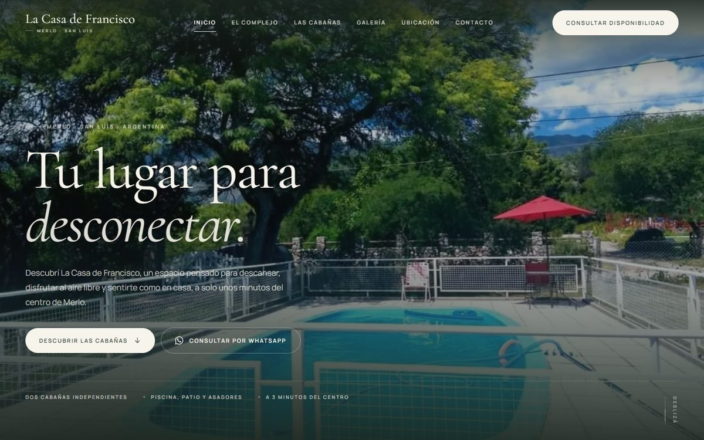
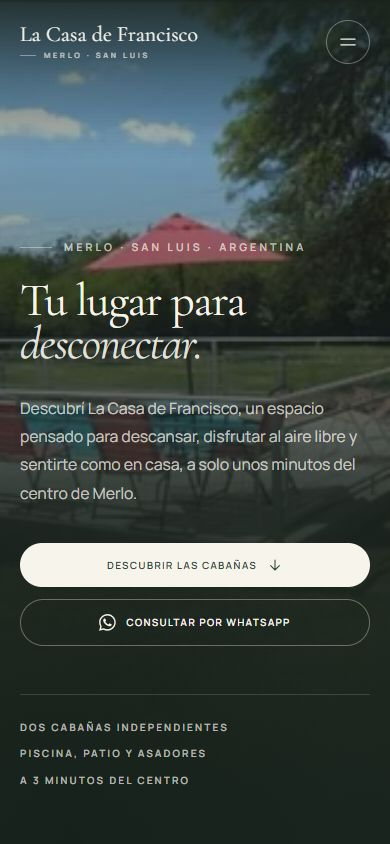

# La Casa de Francisco — Merlo, San Luis

Landing page oficial para el complejo de cabañas **La Casa de Francisco**
(Merlo, San Luis, Argentina). Sitio de una sola página, orientado a
conversión por WhatsApp: presenta el complejo, las dos cabañas, los espacios
exteriores, una galería con lightbox y un formulario que arma la consulta.

- **Stack:** React 19 + TypeScript + Vite 7 + Tailwind CSS 4.
- **Sin backend:** no hay servidor, base de datos ni reservas online. Todo el
  contacto se resuelve por WhatsApp (`+54 266 420-5150`).
- **Fotografías reales** del complejo, optimizadas a WebP.
- **Tipografías** Cormorant Garamond + Manrope, autoalojadas.





---

## Puesta en marcha

Requisitos: Node.js 20.19 o superior (o 22.12+).

```bash
pnpm install     # o: npm install
pnpm dev         # http://localhost:5173
```

Build de producción y vista previa:

```bash
pnpm build       # genera dist/
pnpm preview     # sirve dist/ en local
```

> Si usás `npm`, los scripts funcionan igual (`npm run dev`, `npm run build`).

### Publicación

El resultado del build es un sitio estático en `dist/`. Se puede publicar en
Netlify, Vercel, Cloudflare Pages o cualquier hosting con soporte para sitios
estáticos:

- **Build command:** `pnpm build` (o `npm run build`)
- **Publish directory:** `dist`

No hacen falta variables de entorno ni funciones del servidor.

---

## Dónde editar el contenido

Casi todo el contenido está centralizado en **`src/data/site.ts`**:

| Dato | Dónde |
| --- | --- |
| Nombre comercial, navegación | `site.ts` |
| WhatsApp (número internacional) | `WHATSAPP_NUMBER` |
| Teléfono que se muestra | `WHATSAPP_DISPLAY` |
| Enlace de ubicación | `LOCATION_URL` |
| Textos de las cabañas y capacidad | `CABINS` |
| Amenities (piscina, patio, asadores) | `AMENITIES` |
| Galería, epígrafes y filtros | `GALLERY`, `GALLERY_FILTERS` |
| Mensajes de WhatsApp | `MESSAGES` |
| Instagram | `INSTAGRAM_URL` (hoy `null`) |

Los datos estructurados (JSON-LD) y los metadatos SEO están en `index.html`;
la imagen de Open Graph es `public/og-image.jpg`.

### Instagram

No se muestra ningún enlace porque todavía no hay cuenta definida. Cuando
exista, basta con asignar la URL en `INSTAGRAM_URL` (dentro de
`src/data/site.ts`) y el enlace aparece automáticamente en el footer.

### Ubicación

El botón **Cómo llegar** abre el enlace de Google Maps compartido por el
propietario (`LOCATION_URL`). El sitio **no** muestra un mapa embebido porque
no se pudo verificar la dirección ni las coordenadas exactas del complejo: el
enlace compartido redirige a una búsqueda de Google y no expone un punto
público. Si más adelante se confirma la ubicación, se puede:

1. Obtener las coordenadas o el `place_id` desde Google Maps.
2. Reemplazar la tarjeta de ubicación por un `<iframe>` de Google Maps (o un
   componente que lo envuelva) dentro de `src/components/Location.tsx`.

No se deben inventar dirección ni coordenadas: un mapa mal centrado hace que
los huéspedes lleguen al lugar equivocado.

---

## Fotografías

Las imágenes originales están en **`assets/fotos-originales/`** (no se
publican en el sitio). El script `scripts/build-images.py` genera las
versiones WebP en `public/images/` y actualiza
`src/data/image-manifest.json`, que alimenta `src/lib/images.ts`.

Para cambiar o agregar fotos:

1. Reemplazá el archivo en `assets/fotos-originales/` manteniendo el nombre,
   o agregá uno nuevo y sumalo al mapa `PHOTOS` del script.
2. Ejecutá (requiere Python 3 y Pillow):

   ```bash
   python scripts/build-images.py
   ```

3. Si es una foto nueva, agregala también a `GALLERY` en `src/data/site.ts`
   (o a `CABINS`) con su texto alternativo y su epígrafe.

Nombres actuales:

| Archivo | Contenido |
| --- | --- |
| `piscina-merlo.jpg` | Piscina, árbol y sierras (hero de escritorio) |
| `piscina-jardin.jpg` | Piscina y jardín (hero móvil, sección complejo) |
| `piscina-cabanas.jpg` | Piscina y cabañas (Cabaña 1) |
| `galeria-exterior.jpg` | Galería y piscina (Cabaña 2, ubicación) |
| `piscina-detalle.jpg` | Detalle del agua y reposeras |
| `asador.jpg` | Asador de ladrillo bajo techo |
| `patio-terraza.jpg` | Patio y jardín |
| `interior-cocina.jpg` | Cocina |
| `interior-comedor.jpg` | Cocina y comedor |

> Las fotos no permiten distinguir con certeza qué interior corresponde a cada
> cabaña, por eso las imágenes de los interiores se usan sin atribuirlas a una
> cabaña específica.

---

## Estructura

```
├─ index.html               Metadatos, Open Graph, JSON-LD, preloads
├─ public/
│  ├─ images/               WebP generados + og-image.jpg
│  ├─ fonts/                Cormorant Garamond y Manrope (woff2)
│  ├─ favicon.svg
│  └─ robots.txt
├─ assets/fotos-originales/ Fotos originales (fuente del script)
├─ scripts/
│  ├─ build-images.py       Optimización de imágenes y OG
│  └─ build-fonts.py        Descarga y autoaloja las tipografías
└─ src/
   ├─ App.tsx               Composición de secciones
   ├─ components/           Header, Hero, About, Cabins, Amenities,
   │                        Gallery, Lightbox, Location, Contact, Footer…
   ├─ data/site.ts          Datos y textos del negocio
   ├─ lib/                  WhatsApp, imágenes, hooks, utilidades
   └─ styles/               Tailwind, tokens de diseño y fuentes
```

---

## Formulario de consulta

El formulario valida en el navegador y **no envía datos a ningún servidor**:
arma un mensaje con nombre, fechas, huéspedes, cabaña y comentario, y abre
WhatsApp con ese mensaje codificado (`encodeURIComponent`).

Validaciones implementadas:

- Nombre obligatorio (mínimo 2 caracteres).
- Fechas de ingreso y salida obligatorias.
- La salida debe ser posterior al ingreso.
- La Cabaña 2 no admite más de 3 huéspedes.
- El formulario aclara que la reserva no queda confirmada y que las fechas
  están sujetas a confirmación del alojamiento.

---

## Accesibilidad y rendimiento

- Navegación por teclado, foco visible, enlace para saltar al contenido.
- Menú móvil con `aria-modal`, bloqueo de scroll y cierre con `Escape`.
- Lightbox con navegación por teclado (← →), foco contenido y cierre con
  `Escape` o clic fuera.
- Imágenes con `alt` descriptivo, dimensiones explícitas, `srcset` y
  `loading="lazy"` (excepto el hero).
- Animaciones respetuosas de `prefers-reduced-motion`.
- Colores y tipografías definidos como tokens en `src/styles/index.css`.

---

## Pendientes antes de publicar

- [ ] Definir el dominio y actualizar las URLs absolutas de Open Graph
      (`og:image`, `twitter:image`). Hoy son relativas.
- [ ] Agregar `<link rel="canonical">` cuando el dominio esté definido.
- [ ] Definir la cuenta de Instagram (`INSTAGRAM_URL`).
- [ ] Confirmar si se puede obtener la ubicación exacta para un mapa embebido.
- [ ] Revisar la ficha de Google Business Profile con los datos del complejo.
